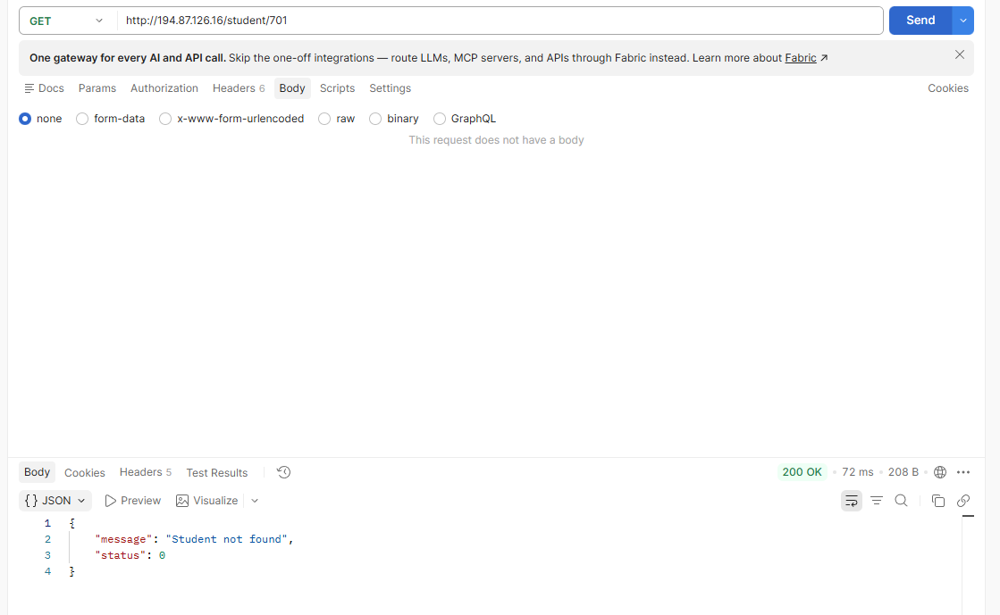
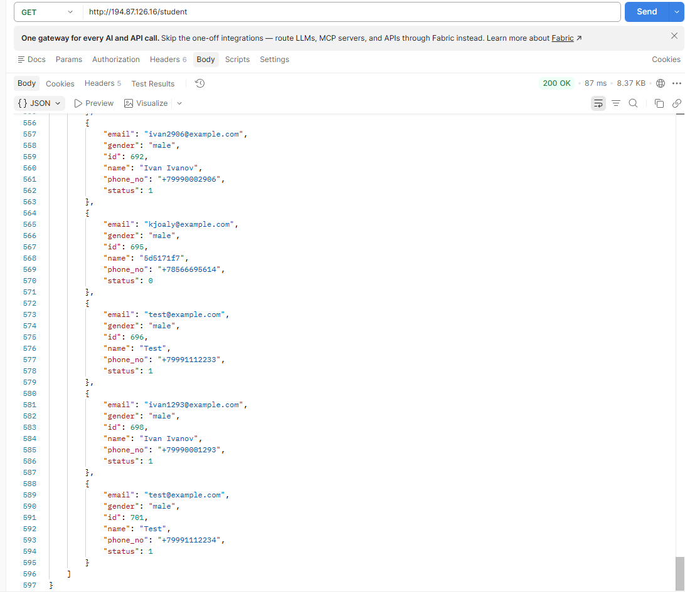
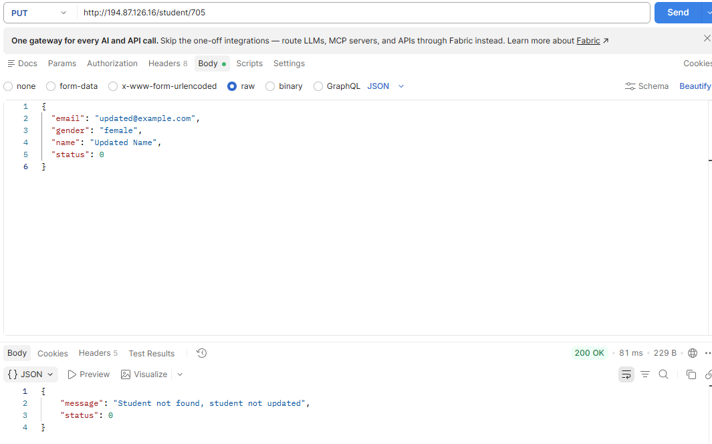

## Дефект №1: Задержка записи (Read-After-Write inconsistency)
**Severity:** Critical
**Priority:** High

**Шаги воспроизведения:**
1. Выполнить `POST /student`. (Успешно создан студент с ID 701).
2. Выполнить `GET /student/701`.

**Фактический результат:** API возвращает 200 OK, но с сообщением "Student not found".


3. Выполнить `GET /student` (список всех).

**Фактический результат:** Студента с ID 701 нет в списке сразу после создания. Через время (или после следующего POST-запроса) он появляется в списке.


---

## Дефект №2: Нарушение Swagger-контракта (HTTP 200 OK вместо 404 Not Found)
**Severity:** Major
**Priority:** Medium
**Окружение:** API Host: `http://194.87.126.16/`

**Описание:**
При попытке получить данные несуществующего студента по эндпоинту `GET /student/{id}`, сервер возвращает статус-код `200 OK` (успех), вместо ожидаемого `404 Not Found`. При этом тело ответа не соответствует Swagger-схеме `GetStudentResponse` (отсутствует объект `student`).

**Шаги воспроизведения:**
1. Отправить `GET /student/999999` (или ID, которого точно нет в базе).
2. Проверить HTTP статус-код ответа.

**Ожидаемый результат:** 
HTTP 404 Not Found. Тело ответа содержит информацию об ошибке (например, `{"error": "Student not found"}`).

**Фактический результат:** 
HTTP 200 OK. Тело ответа: `{"message": "Student not found", "status": 0}`.
Это приводит к ошибкам валидации на стороне клиента (Pydantic ValidationError), так как клиент ожидает получить структуру `{"status": 1, "student": {...}}`.

---

## Дефект №3: Невозможность обновления данных студента (PUT) сразу после создания
**Severity:** Critical
**Priority:** High
**Окружение:** API Host: `http://194.87.126.16/`

**Описание:**
Эндпоинт `PUT /student/{id}` возвращает ошибку при попытке обновить данные только что созданного студента. Вместо ожидаемого объекта `student` API возвращает `{"message": "Student not updated", "status": 0}` со статус-кодом `200 OK`. Это приводит к сбою валидации на клиенте (`ValidationError`) и делает невозможным использование функции редактирования профиля.

**Шаги воспроизведения:**
1. Отправить `POST /student` с валидными данными. Зафиксировать `id` из ответа (например, `id: 702`).
2. Отправить `PUT /student/702` с валидным телом запроса:
   ```json
   {"email":"updated@example.com","gender":"female","name":"Updated Name","status":0}
   
3.Проверить статус-код и тело ответа.

Ожидаемый результат:
HTTP 200 OK. 

Тело ответа:
`{"message": "Student updated successfully", "status": 1, "student": {"id": 702, "name": "Updated Name", ...}}`

Фактический результат:

HTTP 200 OK. Тело ответа: {"message": "Student not updated", "status": 0}.
Объект student в ответе отсутствует, что нарушает Swagger-схему UpdateStudentResponse и приводит к падению клиента с ошибкой ValidationError.

---

## Дефект №4: Некорректный HTTP статус при ошибке валидации (200 OK вместо 400 Bad Request)
**Severity:** Major
**Priority:** Medium
**Окружение:** API Host: `http://194.87.126.16/`

**Описание:**
В соответствии со Swagger, для полей `email`, `phone_no`, `name` валидация не предусмотрена (дефектом не считается). Однако для полей `status` и `gender` валидация на сервере присутствует (студент не создается). При этом API нарушает REST-контракт: при ошибке валидации возвращается статус `200 OK` вместо `400 Bad Request`.

**Шаги воспроизведения:**
1. Отправить `POST /student` со статусом вне допустимого диапазона:
   ```json
   {"email":"test@example.com","gender":"male","name":"Test","phone_no":"+79991112233","status":99}
2. Отправить POST /student с невалидным полом:
json
{"email":"test@example.com","gender":"unknown","name":"Test","phone_no":"+79991112233","status":1}


Ожидаемый результат:

HTTP 400 Bad Request (или 422 Unprocessable Entity). Клиент должен понимать, что запрос отклонен.

Фактический результат:

HTTP 200 OK. Тело ответа: {"message": "Wrong status, student not created", "status": 0}.
Из-за статуса 200 клиентские приложения будут считать, что запрос прошел успешно, и попытаются прочитать объект student, что приведет к ошибке парсинга.